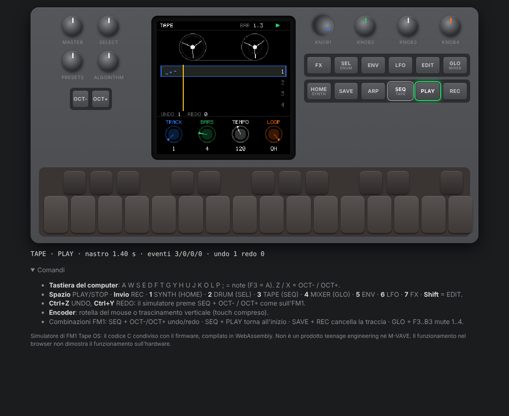
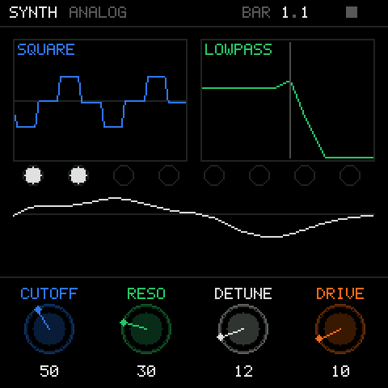
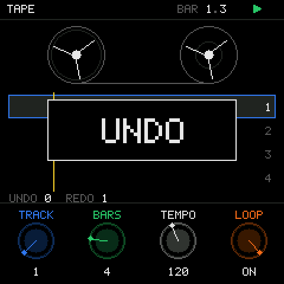
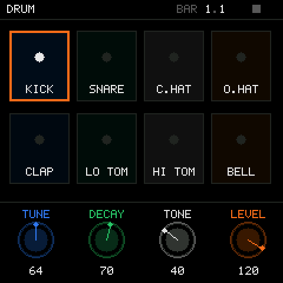
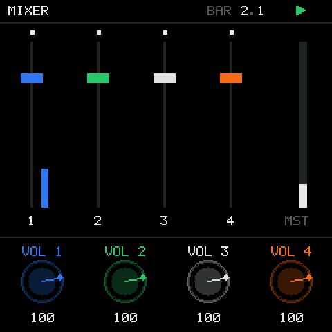

# FM1 Tape OS

Un sistema operativo per l'**M-VAVE FM1** ispirato al workflow del Teenage Engineering **OP-1** e al firmware custom **#248** di Maiko Pruett: quattro modalità (SYNTH, DRUM, TAPE, MIXER), quattro parametri colorati sugli encoder, grafiche legate al suono reale, un nastro a quattro tracce con undo/redo a 7 livelli.

Lo stesso codice C gira in tre posti: **sull'FM1** (build pi32v2 sopra il platform di Dinghy), **nel browser** (WebAssembly in un AudioWorklet) e **sul computer** (test).

> **Stato (2026-10-10).** Prima iterazione, *vertical slice* funzionante nel simulatore web e nei test. La build FM1 compila e linka; il pacchetto `.fwsc` non è stato prodotto (manca l'SDK AC79). **Non è mai stato eseguito su un FM1.** Nessun flash è stato fatto.
>
> Non è un prodotto teenage engineering, M-VAVE o Maiko Pruett. Non contiene firmware, grafica, font o suoni dell'OP-1.



| SYNTH | TAPE (undo) | DRUM | MIXER |
|---|---|---|---|
|  |  |  |  |

*Schermate prodotte dal renderer reale (240×240, ingrandite 2×).*

## Cosa funziona davvero

Funziona nei test host e nel browser; **sull'FM1 non è verificato**.

- **SYNTH**
  - Motore ANALOG di Felucca (2 oscillatori band-limited, noise, drive, filtro SVF LP/BP/HP), 8 voci, 12 preset.
  - Pagine ENV (ADSR, env→cutoff), LFO (4 forme, 4 destinazioni), FX (delay ping-pong).
  - Grafiche dallo stato DSP: forma d'onda dagli oscillatori reali, filtro con cutoff modulato, scope dell'audio, voci.
- **DRUM:** 8 suoni sintetizzati (kick, snare, hat chiuso e aperto, clap, tom, bell), 4 parametri per suono, pad illuminati dal livello reale.
- **TAPE (EventTape)**
  - 4 tracce di note ed eventi di batteria; play, stop, rec, overdub, loop da 1 a 16 battute, tempo da 60 a 200, erase.
  - **Undo/redo a 7 livelli** (SEQ + OCT− / OCT+, popup), anche in play o durante una registrazione in loop.
  - Clock a campione (1 tick = 32 frame).
- **MIXER:** volume, pan, mute per traccia, master, meter di picco reali, carico CPU (solo sull'FM1).
- **Simulatore**
  - Pannello FM1 (encoder, 14 pulsanti, 27 tasti, LED), tastiera del computer, Ctrl+Z / Ctrl+Y.
  - Web MIDI (non testato con un dispositivo).
- **Test:** 45 sul nastro, 31 sull'audio (WAV e hash), 103 sulla UI, 17 end-to-end in Chromium; build FM1 con i controlli di sicurezza di Dinghy.

**Non ancora:**
- persistenza;
- altri motori;
- arpeggiatore e sequencer;
- editing dei clip;
- punch-in temporizzato;
- **AudioTape**: il nastro registra eventi, non audio; perché, è spiegato in `docs/ARCHITECTURE.md` §5.

## Avviare il simulatore

Requisiti: `clang` con target wasm32 e `wasm-ld` (Ubuntu: `sudo apt install clang lld`), `python3`. Su Windows usare WSL2 Ubuntu, oppure clang per Windows più Python.

```sh
platform/web/build.sh                          # -> build/web/ (tapeos.wasm ~88 KB + pagina)
python3 -m http.server 8790 -d build/web
```

Aprire **http://localhost:8790/** in Chrome o Edge e premere **POWER ON**: l'audio parte solo dopo un clic.

**Comandi:**
- **Note:** A W S E D F T G Y H U J K O L P ; (F3 = A).
- **Ottava:** Z / X = OCT− / OCT+.
- **Transport:** Spazio = PLAY/STOP, Invio = REC.
- **Modalità:** 1 SYNTH, 2 DRUM, 3 TAPE, 4 MIXER, 5 ENV, 6 LFO, 7 FX.
- **Seconda riga di parametri:** Shift = EDIT.
- **Undo/redo:** Ctrl+Z / Ctrl+Y.
- **Encoder:** rotella del mouse o trascinamento verticale.

**Prova rapida del nastro:** `3` (TAPE) → `Invio` (REC: arma e parte) → suona qualche nota → `Invio` (fine take) → `Ctrl+Z` (UNDO) → `Ctrl+Y` (REDO).

## Test

```sh
tests/run_tests.sh                              # host (tape, audio, UI) + build wasm + smoke test Node
WEB=1 tests/run_tests.sh                        # + test end-to-end in Chromium (Playwright)
FM1=1 JIELI_TOOLCHAIN=~/.jieli/toolchain tests/run_tests.sh   # + build FM1
```

Gli screenshot vanno in `build/test/ui_*.png` e `build/test/web_*.png`, i WAV in `build/test/*.wav`. Risultati e limiti: [`docs/TEST_REPORT.md`](docs/TEST_REPORT.md).

## Compilare per l'FM1

Vedi [`docs/BUILD_FM1.md`](docs/BUILD_FM1.md): WSL2, toolchain JieLi, SDK facoltativo.

```sh
firmware/tools/get_toolchain.sh && export JIELI_TOOLCHAIN=~/.jieli/toolchain
python3 firmware/tools/build.py     # -> build/fm1/tapeos.bin; tapeos.fwsc solo con AC79_SDK
```

Risultato verificato: immagine di 54 376 B su 581 564; RAM 25 632 B su 98 304; pool 283 288 B su 344 064; controlli Dinghy superati.

## ⚠ Sicurezza

- **Nessuno strumento di questo repository installa o flasha automaticamente.** Non installare su un FM1 senza aver fatto prima un backup completo della flash e aver letto `docs/BUILD_FM1.md` §3.
- Il funzionamento nel browser **non** dimostra il funzionamento sull'hardware.
- Le vie di recupero esistono (rescue di Dinghy con OCT− all'accensione, UBOOT della ROM via FM-1-transporter), ma non sono state verificate da noi.

## Struttura

| Percorso | Contenuto |
|---|---|
| `src/` | applicazione condivisa (unity build `src/tapeos.c`): `core/` (comandi, parametri, mappatura del pannello), `audio/` (synth, drum, mixer), `tape/` (EventTape e undo), `ui/` (framebuffer, font, schermate) |
| `third_party/felucca/` | motore ANALOG e DSP di Felucca, verbatim |
| `platform/web/`, `web/` | adattatore WebAssembly, AudioWorklet, pagina |
| `platform/host/` | harness per i test |
| `firmware/` | platform Dinghy (verbatim), adattatore `src/fm1_tapeos.c`, `tools/build.py` |
| `tests/` | test host, golden audio, test browser, `run_tests.sh` |
| `docs/` | [ricerca](docs/TECHNICAL_RESEARCH.md), [decisione](docs/ARCHITECTURE_DECISION.md), [architettura](docs/ARCHITECTURE.md), [build FM1](docs/BUILD_FM1.md), [test](docs/TEST_REPORT.md), [roadmap](docs/ROADMAP.md) |
| `research/` | studio del firmware OP-1 #246/#248 (fase precedente): estrazione, binario Blackfin, patch di Maiko, limiti FM1 |
| `tools/` | strumenti di ricerca sul firmware OP-1, generatore del font |

## Crediti e licenze

Licenza **GPL-3.0-only** (`LICENSE`). Il dettaglio è in [`THIRD_PARTY_NOTICES.md`](THIRD_PARTY_NOTICES.md).
- **[Felucca](https://github.com/hugelton/Felucca)** di Leo Kuroshita / Hügelton Instruments: motore ANALOG, DSP e tabelle; architettura del simulatore web.
- **[Dinghy](https://github.com/zvenson/dinghy)** (dal platform di Felucca / SLOOP / sloopDX): tutto il platform FM1 e gli strumenti di build.
- **[FM-1-RE](https://github.com/AL-255/FM-1-RE)**, **[FM-1-transporter](https://github.com/kurogedelic/FM-1-transporter)**: dati hardware e recupero.
- **OP-1 OS #248** di Maiko Pruett: riferimento funzionale per undo/redo del nastro (nessun codice usato).
- **[op1hacks](https://github.com/op1hacks)**, **[op1emu](https://github.com/op1emu/op1emu)**: strumenti usati nella ricerca.
